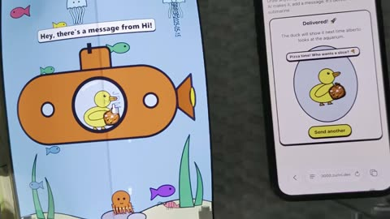

<h1>Hi  I'm Alberto</h1>

**Indie hacker & serial hackathon builder.** I build things in a weekend, ship them to real people and occasionally they get used.
By day: AI-native software engineer (agents, evals, LLM inference). By night: whatever idea didn't let me sleep.

> 🏆 **20+ hackathon prizes** · 📱 **10k+ app downloads** · 🔓 **[1 ISP responsibly hacked](https://github.com/albertoZurini/icmp_tunnel_poc)**

  
  
  
  
  

> **Heads up:** most repos here are hackathon code. Written in 36 hours, fueled by free pizza, judged by tired people. Ain't much, but it's honest work.

##  Shipped to real users

| Project | What | Traction |
|---|---|---|
| [**Echo Dot 2 Playground**](https://github.com/albertoZurini/echo-dot-2-playground) | Rooted a $5 Amazon Echo Dot 2 and ran a 25.8M-param LLM on it (512MB RAM, 16/8 tok/s prefill/decoding). First on the device. | ⭐ 200+ stars |
| [**iOS 6 Simulator**](https://ios6-simulator.vercel.app/) | Reddit kept posting skeuomorphic iOS 6 screenshots, but nobody could *use* one. So I built it and shipped from their comments. | ~400 DAU, $0 marketing |
| [**Mappa Zone Italia**](https://www.facebook.com/mappazoneitalia/) | Real-time map of Italy's COVID restriction zones. | 10k Google Play downloads |
| [**Fake-follower tracker**](https://james-charles-followers-count.vercel.app/) | Built in a hurry to ride an influencer drama. | 10k visits/day, 2.5M+ TikTok views, $80 in donations (thanks!) |
| [**NerfTube**](https://github.com/albertoZurini/NerfTube) | Chrome extension that makes YouTube boring on purpose: grayscale + throttled FPS. | Solved my YouTube addiction |
| [**ESP32 EMF Detector**](https://github.com/albertoZurini/ESP32-EMF-DETECTOR) | An ESP32, a resistor and a flying wire turned into an EMF detector with a web UI. | ⭐ 7 stars |

##  Responsible disclosure

[**Iliad ICMP tunnel**](https://github.com/albertoZurini/icmp_tunnel_poc): found a data-quota bypass on Iliad, an Italian ISP with 10M subscribers, by tunneling traffic over ICMP. Reported it and it's now patched. Sorry for the free internet, Iliad.

##  Hackathon trophy wall

Newest first. If it has a repo, you can clone it. If it doesn't run, remember the pizza.

| When | Event | Built | Result |
|---|---|---|---|
| 2026-11 | Meta Global AI Developer Hackathon | [**DuckMail**](https://github.com/albertoZurini/meta-ai-hackathon-2026): a desk aquarium where a duck in a submarine delivers messages from faraway friends. Built solo, drawings included. | No prize, but I have a digital aquarium now!  |
| 2026-09 | ETHOnline 2026 | [**AutoAMM**](https://github.com/albertoZurini/ethglobal-online-2026): an agent tunes AMM fees and capital, rejects unsafe candidates and compiles the winner to 1inch Aqua / SwapVM. | Built, no prize |
| 2026-09 | Build with Gemini XPRIZE | [**ServiceConnected**](https://devpost.com/software/serviceconnected): helps US veterans build stronger VA disability claims, with a rating calculator. Built by veterans for veterans. | Built, no prize |
| 2026-05 | Colosseum Frontier 2026 | [**Cryptorights**](https://github.com/albertoZurini/colosseum-frontier-2026): experts sell knowledge as paywalled APIs; every AI agent query pays them in USDC on Solana. | Built, no prize |
| 2026-04 | PL_Genesis: Frontiers of Collaboration | [**Decycle**](https://ethglobal.com/showcase/decycle-ke8bj) (v2): the smart trash can, improved. | 🥇 Physical AI: Most Improved Project   🏅 Existing Code, Top 10 |
| 2026-02 | Pulse AI Miami Hackathon | [**Pulse: My Adventure**](https://github.com/albertoZurini/Pulse-AI-Miami-Hackathon): a game-like app where people with intellectual disabilities practice CBT therapy skills between sessions, with YOLO object detection + sound cues. | 🎨 Most Creative Project |
| 2025-08 | ETHGlobal New York 2025 | [**TollBooth**](https://github.com/albertoZurini/ETHGlobal-New-York-2025-Zircuit): charge bots micro-fees (HTTP 402) instead of blocking them with captchas ([Flow repo](https://github.com/albertoZurini/ETHGlobal-New-York-2025-Flow) · [showcase](https://ethglobal.com/showcase/tollbooth-yoi3r)). | 🥈 Flow: Best Use of Actions & Agents (2nd) 🏅 Flow Builder Pool Prize |
| 2025-06 | ETHGlobal Cannes 2025 | [**ChromaMind**](https://github.com/ChromaMind): a VR headset with 40Hz light and binaural beats for relaxation, with Rust BLE firmware ([firmware](https://github.com/ChromaMind/firmware) · [mini app](https://github.com/ChromaMind/mini-app) · [showcase](https://ethglobal.com/showcase/chromamind-4cx83)). | 🏆 ETHGlobal Cannes Finalist 🏅 World: Best Mini App (Honorable Mention) |
| 2025-06 | ETHGlobal Prague 2025 | [**Decycle**](https://ethglobal.com/showcase/decycle-ke8bj): a smart trash can that sorts garbage with computer vision and rewards people who recycle. Hardware PoC in 20 days. | 🏅 Blockscout Explorer Pool Prize |
| 2025-03 | ETHGlobal Trifecta 2025 | [**ZKFlow**](https://github.com/albertoZurini/Trifecta-2025): drag-and-drop builder for zero-knowledge circuits, with an AI assistant. | Built, no prize |
| 2024-11 | ETHGlobal Bangkok 2024 | [**Crypto PoS**](https://github.com/albertoZurini/ETHWarsaw2024) (v2): tap-to-pay crypto in under 500ms over custom ISO14443, plus ZK tax compliance. | 🏅 Bounty |
| 2024-10 | ETHSofia 2024 | [**ZKLauren**](https://github.com/albertoZurini/ETHSofia2024): companies prove their tax statements with zero-knowledge proofs, without revealing their books. | 🏅 Featured use case on the EU's [SEEBLOCKS.eu](https://seeblocks.eu) project |
| 2024-10 | [REDACTED] Hackathon | [**Ne-ar-yo**](https://github.com/albertoZurini/redacted2024): Android NFC tap-to-pay for blockchain payments. | Built, no prize |
| 2024-10 | ETHOnline 2024 | [**Crypto PoS**](https://github.com/albertoZurini/ETHWarsaw2024): NFC point-of-sale with zkVerify privacy and ENS. | Built, no prize |
| 2024-09 | ETHWarsaw 2024 | [**Crypto PoS**](https://github.com/albertoZurini/ETHWarsaw2024): an NFC point-of-sale for crypto on 5 chains. | 🏅 Request Network bounty 🥉 Celo track, 3rd place ➕ and more |
| 2023-03 | START Hack 2023 | [**Quantitative Chamber**](https://github.com/albertoZurini/quantitative_chamber_starthack23): BIP-85 Bitcoin treasury wallet for companies. | 🥇 1st place, BlockFinance sponsor case ✈️ Trip to the Canary Islands 🎤 Finalist pitch on the main stage |
| 2023-03 | LauzHack Sustainability 2023 | [**DISCO on ASICs**](https://devpost.com/software/asic-powered-distributed-collaborative-machine-learning): ASIC-powered distributed collaborative machine learning. | 🎧 Eco-friendly headphones |
| 2019-05 | First Udine Hackathon (PwC) | [**Smart robot to-do flow**](https://github.com/albertoZurini/hackathon-udine-brovedani-pwc): an Omron LD-60 robot + Node-RED + Azure. | 🥇 1st place |

…and a few more that never got a repo. Pizza count: unknown.

---

If any of this made you smile (or saved you a weekend), <a href="https://www.buymeacoffee.com/albertozurini">buy me a coffee ☕</a>. It funds the next hackathon.
